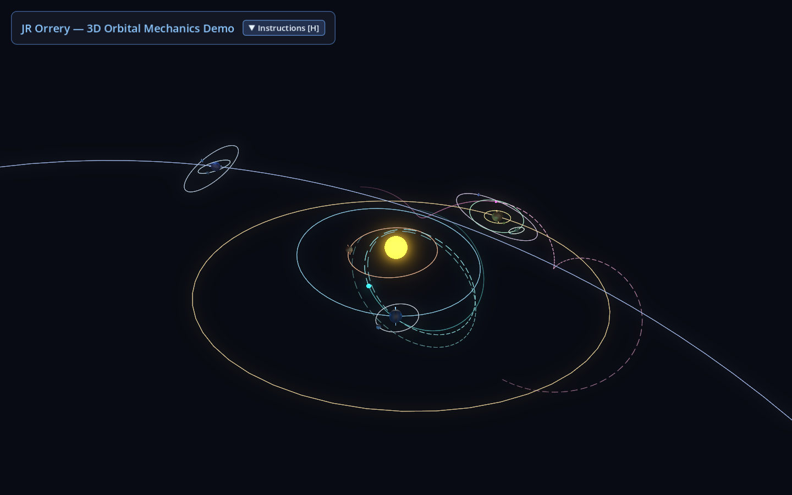
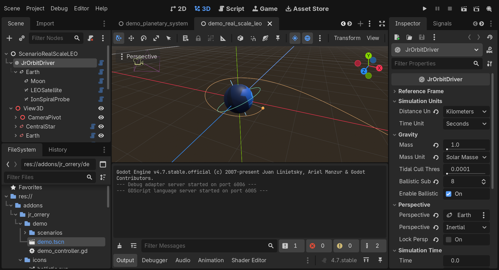
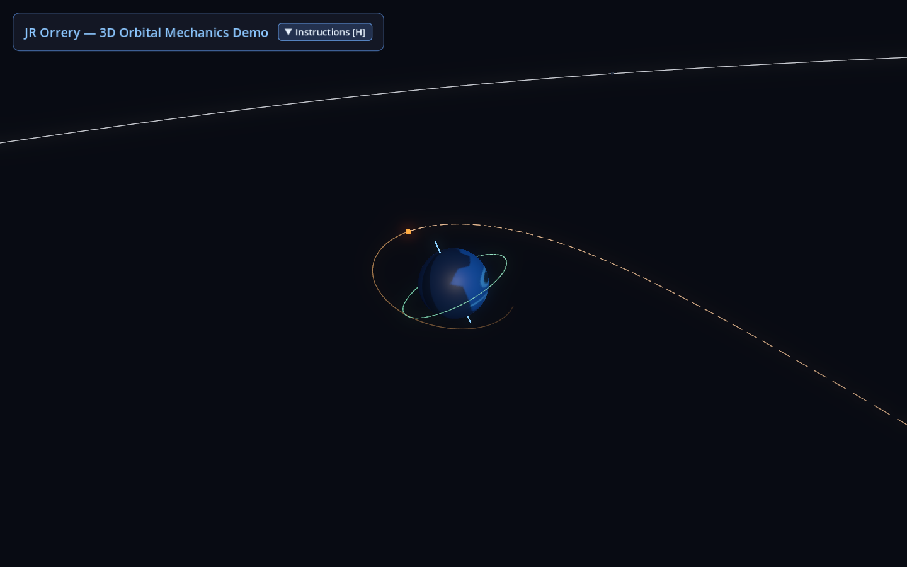
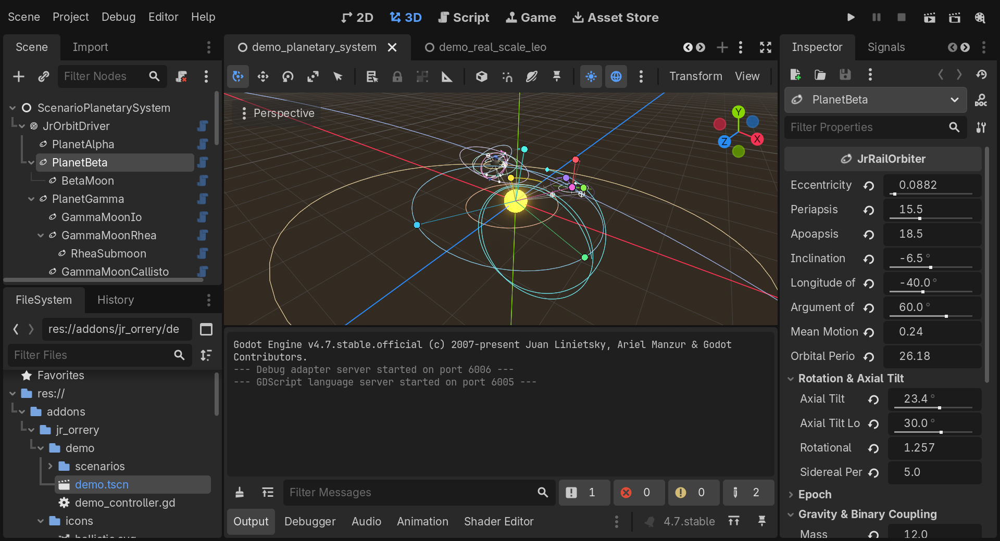
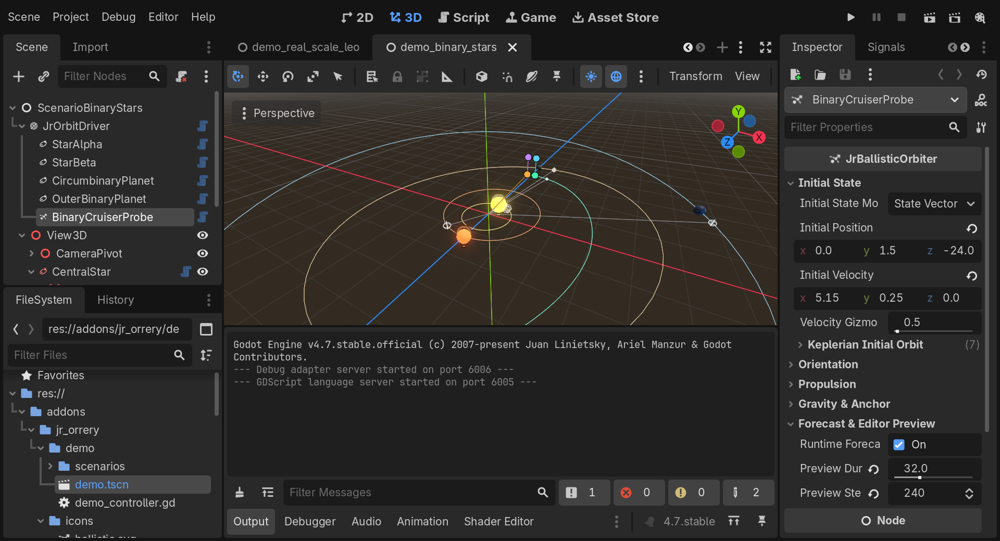
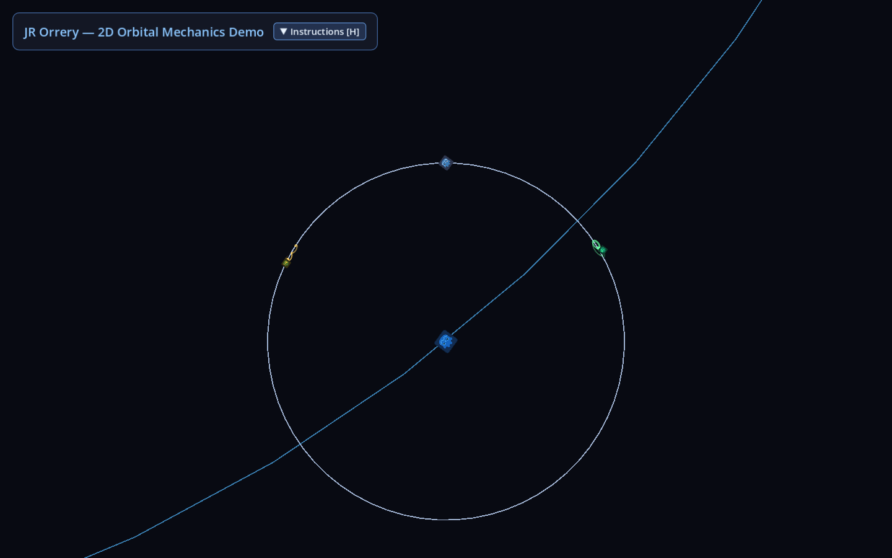
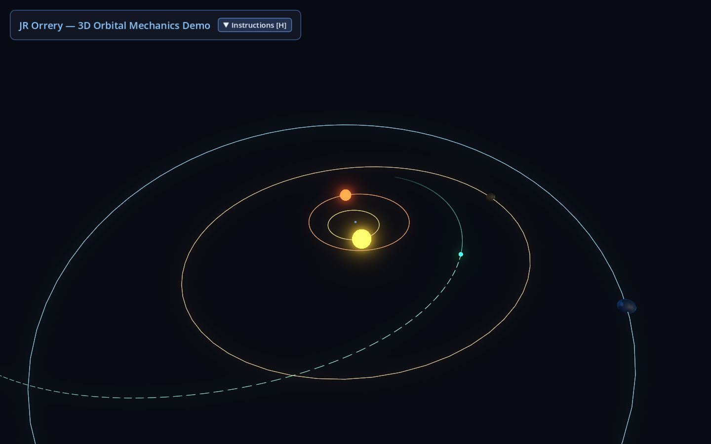
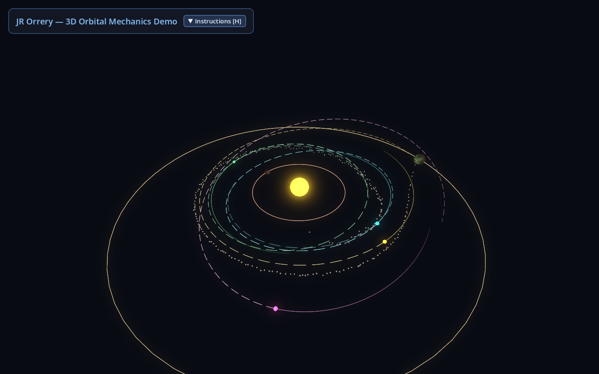

# JR Orrery

**JR Orrery** is a Godot 4.7+ plugin for building solar systems, planetary orbits, spacecraft trajectories, and orbital maps in **2D**, **3D**, or both at the same time.

Building space games in a standard game engine usually runs into two big problems:
1. **Scale**: Real space distances span millions of kilometers, which breaks standard 3D camera clipping planes, shadows, and 32-bit floating-point coordinates—or forces you to fake orbital speeds and sizes by hand.
2. **Reference Frames**: Sometimes the camera needs to follow a star system from above, sometimes it needs to hover over a spinning planet, and sometimes it needs to stay centered on a tiny spacecraft in Low Earth Orbit.

**JR Orrery** solves both problems by separating **orbital simulation** from **visual gameplay nodes**:
- **Simulation nodes** (`JrOrbitDriver`, `JrRailOrbiter`, `JrBallisticOrbiter`) calculate accurate 3D orbits, multi-body gravity, spacecraft thrust, and trajectory forecasts behind the scenes—using either real-world astronomical units or custom game numbers.
- **Visual follower nodes** (`JrOrbiter2D` and `JrOrbiter3D`) read that simulation, scale the distances down into comfortable Godot scene coordinates, and move your meshes, sprites, cameras, or map icons.



---

## Simulation Scale vs. Gameplay Scale

One of the core ideas behind JR Orrery is that **the physics scale of your solar system does not have to match the visual coordinate scale of your Godot scene**.

### 1. Real Scale in the Simulation
Inside `JrOrbitDriver`, `JrRailOrbiter`, and `JrBallisticOrbiter`, you can build systems at real astronomical sizes—or any consistent unit system you choose (`Kilometers`, `Astronomical Units`, `Earth Radii`, `Seconds`, `Days`, `Solar Masses`, `Earth Masses`, `m/s²`, `g`, etc.):
- A planet can orbit `150,000,000 km` (`1 AU`) from its star while a satellite orbits just `400 km` above that planet's surface.
- Orbital periods, escape velocities, slingshots, Lagrange points, and thruster delta-v all work naturally using real numbers—without manually tuning fake gravity values.
- Under the hood, JR Orrery tracks orbits relative to their local parent body rather than subtracting huge solar-system-wide coordinates, so a small satellite orbiting a distant planet never suffers from floating-point jitter.

### 2. Gameplay Scale in 2D and 3D Nodes (`position_scale`)
Placing a `Node3D` at `x = 150,000,000` in Godot would cause severe rendering jitter, broken shadow maps, and camera frustum issues. Instead, `JrOrbiter3D` and `JrOrbiter2D` provide a **`position_scale`** property that converts simulated distances into practical scene units:

- **Keep Scene Coordinates Comfortable**: Multiply large simulated distances down into normal Godot ranges. For example, if the simulation runs in **Kilometers**, setting `position_scale = 0.001` on `JrOrbiter3D` maps `1,000 km` to `1.0` Godot 3D unit—putting a `6,778 km` Low Earth Orbit at a crisp `6.78` units from Earth's center.
- **Size Planets & Ships for Gameplay (or True Scale)**: `position_scale` only scales **orbital positions**, never the `scale` or rotational `Basis` of your visual child nodes. You can make a spacecraft mesh, collider, or 2D map icon large enough for the player to see and click without affecting its physics—or match mesh radii to `position_scale` whenever you want true 1:1 planetary proportions.
- **Drive a 3D World and a 2D Tactical Map Together**: Because each visual follower has its own `position_scale`, a single `JrOrbitDriver` simulation can simultaneously drive:
  - A **3D flight view** (`JrOrbiter3D` with `position_scale = 0.001` in 3D meters/units), and
  - A **2D navigation map or radar display** (`JrOrbiter2D` with `position_scale = 0.015` in screen pixels).
- **Keep the Active Body at `(0, 0, 0)`**: Setting `perspective_node` on `JrOrbitDriver` locks any chosen planet, moon, or player ship to `(0, 0, 0)` in scene space and shifts the rest of the system around it *before* applying `position_scale`. Your gameplay camera, physics shapes, and VFX always operate right near the scene origin with full precision.

### Example: Real-Scale LEO vs. 3D & 2D Gameplay Coordinates
From the included `demo_real_scale_leo.tscn` scenario (`distance_unit = KILOMETERS`, `perspective_node = Earth`):

| Body / Value | Simulation Value (Real Scale) | 3D Scene (`position_scale = 0.001`) | 2D Map (`position_scale = 0.015`) |
| :--- | :--- | :--- | :--- |
| **Earth** (Active Origin) | `147,098,074 km` from Sun | `(0, 0, 0)` — `4.2` unit sphere | Map center — `Sprite2D` icon |
| **LEO Satellite** | `6,778 km` from Earth center | `6.78` units from Earth | `101.7 px` from Earth |
| **Moon** | `363,300 km` from Earth | `363.3` units from Earth | `5,449.5 px` from Earth |
| **Sun** | `147,098,074 km` away | `147,098` units away | `2,206,471 px` away |


*Godot Editor view of `demo_real_scale_leo.tscn`: `JrOrbitDriver` runs in **Kilometers**, **Seconds**, and **Solar Masses** with `Perspective` locked to `Earth`, while `View3D` (`JrOrbiter3D`, `position_scale = 0.001`) renders Earth, the 400 km LEO satellite, and the low-thrust ion spiral right at `(0, 0, 0)`.*



---

## Custom Nodes

Enabling the plugin adds five custom nodes to Godot's **Create New Node** dialog:

| Node | Inherits | What It Does |
| :--- | :--- | :--- |
| **`JrOrbitDriver`** | `Node` | The root controller of an orbital system. Controls simulation time, time warp (`time_scale`), physical units, system plane orientation, and which body sits at the scene origin (`perspective_node`). |
| **`JrRailOrbiter`** | `Node` | An "on-rails" body (star, planet, moon, comet) that follows an exact Keplerian orbit (circular, elliptical, parabolic, or hyperbolic) with configurable axial tilt and day/night spin. |
| **`JrBallisticOrbiter`** | `Node` | A free-flying physics body (spacecraft, probe, asteroid, missile) affected by gravity from all massive bodies in the system, continuous engines, and instant delta-v burns. |
| **`JrOrbiter3D`** | `Node3D` | Moves and rotates a 3D node (meshes, cameras, lights, physics bodies) to follow a `JrRailOrbiter`, `JrBallisticOrbiter`, or `JrOrbitDriver`. |
| **`JrOrbiter2D`** | `Node2D` | Projects a body's 3D motion onto a top-down 2D `Node2D` plane (`Vector2(x, z) * position_scale`), with optional 2D rotation sync. |

---

## Key Features

### Planetary Systems & "On-Rails" Orbits (`JrRailOrbiter`)
- **Closed & Escape Orbits**: Supports circular (`eccentricity = 0`), elliptical (`0 < eccentricity < 1`), parabolic (`eccentricity = 1`), and hyperbolic (`eccentricity > 1`) paths.
- **Moons, Submoons & Deep Hierarchies**: Nest `JrRailOrbiter` nodes as deep as you want (Star → Planet → Moon → Submoon).
- **Axial Tilt & Sidereal Spin**: Configure planetary seasons and day lengths with `axial_tilt`, `axial_tilt_longitude`, `sidereal_period` (or `rotational_motion`), and `rotation_at_epoch`.
- **Automatic Gravity-Based Orbital Speeds**: Turn on `sync_motion_to_gravity` to automatically calculate orbital speed and `orbital_period` from the parent body's mass and the orbit's size.
- **Binary Stars & Circumbinary Worlds**: Link two sibling `JrRailOrbiter` nodes under a massless barycenter (`mass = 0`) using `binary_partner`. Adjusting one star's orbit or mass automatically updates its partner's counterweight distance, opposite periapsis, and shared orbital period—and any planets parented to the barycenter automatically feel the combined gravity of both stars.

### Physics-Driven Spacecraft, Transfers & Asteroid Swarms (`JrBallisticOrbiter`)
- **GPU-Accelerated N-Body Gravity**: Steps hundreds of ballistic bodies in parallel on the GPU using GLSL compute shaders (and automatically falls back to an identical CPU solver in headless or Compatibility builds).
- **Multi-Body Gravity, Slingshots & Lagrange Points**: Bodies feel gravitational pull from the central star, planets, and moons simultaneously, enabling realistic lunar free-return trajectories, gravity assists, and stable L4/L5 Trojan orbits.
- **Automatic Sphere-of-Influence Handoffs**: As a spacecraft travels from interplanetary space into a planet's or moon's gravity well, JR Orrery automatically switches its dominant reference body (emitting `dominant_body_changed`) so local orbits stay rock-solid. You can also lock a body to a specific reference with `pinned_anchor`.
- **Drift-Free Time Warp**: When a ballistic body has its engines off and isn't being tugged by nearby third bodies, it automatically freezes onto an exact Keplerian orbit so high time-warp speeds won't cause orbits to decay—waking back up the moment thrusters fire or another massive body approaches.
- **Author via Vectors or Orbital Elements**: Set up a spacecraft's starting path using either 3D position/velocity vectors (`STATE_VECTORS`) or standard orbital parameters like periapsis, apoapsis, and inclination (`KEPLERIAN_ELEMENTS`). Both stay in sync automatically.
- **Continuous Thrusters & Instant Burns**:
  - Apply continuous acceleration (`external_acceleration`) for ion drives, low-thrust spirals, or continuous burns in **Inertial**, **Body-Local**, or **Orbital** (Prograde `-Z`, Normal `+Y`, Radial Outward `+X`) directions.
  - Trigger instant delta-v maneuvers from code with `apply_impulse()`, `apply_local_impulse()`, and `apply_orbital_impulse()`.
- **Live Trajectory Forecasting**: Automatically predicts and exposes future flight-path points (`get_forecast_points()`, `get_forecast_points_2d()`), accounting for moving planets, continuous prograde/retrograde burns, and upcoming gravity-well transitions.

### Dynamic Perspectives & Reference Frames (`JrOrbitDriver`)
- **Switch Origin to Any Body (`perspective_node`)**: Center the entire visual scene on a planet, moon, space station, or spacecraft at runtime without changing how the physics simulation runs.
- **Three Reference Frame Modes (`PerspectiveRotationMode`)**:
  - **`INERTIAL`**: Keeps the chosen body at `(0, 0, 0)`, while the background coordinate axes stay fixed to the stars.
  - **`BODY_SPIN`**: Rotates the universe with the chosen body's surface spin—ideal for surface bases, launchpads, or geostationary views.
  - **`SYNODIC_ORBITAL`**: Rotates the view along with the chosen body's orbit around its parent, making Lagrange points (L1–L5) and transfer loops appear stationary.
- **Flat 2D Mode (`lock_to_ecliptic`)**: Building a strictly 2D top-down space game? Enable `lock_to_ecliptic` on `JrOrbitDriver` to flatten all inclinations, ballistic velocities, thruster burns, and spin axes onto a single plane (while still allowing both clockwise/prograde and counter-clockwise/retrograde orbits).

### Built-In Physical Units (`JrOrreryUnits`)
Mix and match real-world units in the Inspector without looking up gravitational constants:
- **Distance**: `METERS`, `KILOMETERS`, `MEGAMETERS`, `EARTH_RADII`, `LUNAR_DISTANCES`, `ASTRONOMICAL_UNITS`
- **Time**: `SECONDS`, `MINUTES`, `HOURS`, `DAYS`, `YEARS`
- **Mass**: `DRIVER_GM` (custom raw gravity), `KILOGRAMS`, `METRIC_TONS`, `TERAGRAMS`, `LUNAR_MASSES`, `EARTH_MASSES`, `JUPITER_MASSES`, `SOLAR_MASSES`
- **Acceleration**: `DRIVER_UNITS`, `METERS_PER_SECOND_SQUARED`, `STANDARD_GRAVITIES_G` (`1 g = 9.80665 m/s²`)

### Flexible Scene Layouts (`TransformMode`)
`JrOrbiter2D` and `JrOrbiter3D` support both nested and flat visual scene trees:
- **Nested Visual Trees (`LOCAL`)**: Parent a moon's `JrOrbiter3D` under a planet's `JrOrbiter3D`. The planet's axial tilt and daily spin are automatically canceled out so the moon's orbit doesn't wobble as the planet spins.
- **Flat Visual Trees (`SYSTEM`)**: Place all `JrOrbiter3D` or `JrOrbiter2D` nodes side by side under one parent node—ideal when switching `perspective_node` between arbitrary bodies at runtime.
- **Automatic (`AUTO`)**: Uses `LOCAL` when parented to another `JrOrbiter2D`/`JrOrbiter3D`, and `SYSTEM` otherwise.

### Interactive 2D & 3D Editor Tools
- **Click-and-Drag Viewport Gizmos**: Select an orbiter or its 2D/3D visual node in the editor to drag Periapsis, Apoapsis, Eccentricity, Ascending Node, Inclination, Axial Tilt, Epoch Position, or Ballistic Velocity vectors directly in the 2D or 3D viewport—complete with Undo/Redo.
- **Animated Editor Ghosts**: Preview orbital speeds, flybys, planet spin, and curved N-body trajectories right inside the editor (`editor_play_speed`) without dirtying or modifying your saved scene transforms.
- **Accidental Drag Protection**: If you accidentally drag a simulation-driven `JrOrbiter2D` or `JrOrbiter3D` with Godot's Move tool, it warns you and snaps back to its true orbital position so your scene never gets out of sync.

---

## Installation

1. Copy the `addons/jr_orrery` folder into your Godot 4.7+ project's `addons/` directory.
2. Open **Project > Project Settings > Plugins** and enable **JR Orrery**.

---

## Quick Start

### 1. Set Up a Solar System Scene
Create a `JrOrbitDriver` branch for your simulation data, and a `Node3D` (or `Node2D`) branch for your game visuals:

```text
MainScene
├── JrOrbitDriver (mass = 1.0 SOLAR_MASSES, distance_unit = ASTRONOMICAL_UNITS, time_unit = DAYS)
│   ├── Earth (JrRailOrbiter: periapsis = 1.0, sync_motion_to_gravity = true, mass = 1.0 EARTH_MASSES)
│   │   ├── Moon (JrRailOrbiter: periapsis = 0.00257, sync_motion_to_gravity = true)
│   │   └── PlayerShip (JrBallisticOrbiter: initial_state_mode = KEPLERIAN_ELEMENTS)
└── GameWorld3D (Node3D)
    ├── SunVisual (JrOrbiter3D: orbiter = JrOrbitDriver, position_scale = 50.0)
    │   └── MeshInstance3D
    ├── EarthVisual (JrOrbiter3D: orbiter = Earth, position_scale = 50.0)
    │   └── MeshInstance3D
    ├── MoonVisual (JrOrbiter3D: orbiter = Moon, position_scale = 50.0)
    │   └── MeshInstance3D
    └── ShipVisual (JrOrbiter3D: orbiter = PlayerShip, position_scale = 50.0)
        └── MeshInstance3D
```

> [!TIP]
> Attaching a `JrOrbiter3D` or `JrOrbiter2D` to the root `JrOrbitDriver` lets your central star's mesh or sprite move automatically whenever you center the system on a planet or ship via `perspective_node`!

### 2. Control Spacecraft & Switch Perspectives in GDScript

```gdscript
extends Node

@export var driver: JrOrbitDriver
@export var earth: JrRailOrbiter
@export var ship: JrBallisticOrbiter


func fire_prograde_boost() -> void:
	# Instantaneously add 0.5 simulation speed units in the prograde (-Z) direction:
	ship.apply_orbital_impulse(Vector3.FORWARD * 0.5)


func engage_ion_drive() -> void:
	# Apply continuous 0.02 m/s^2 prograde thrust:
	ship.thrust_frame = JrBallisticOrbiter.ThrustFrame.ORBITAL
	ship.acceleration_unit = JrOrreryUnits.AccelerationUnit.METERS_PER_SECOND_SQUARED
	ship.external_acceleration = Vector3.FORWARD * 0.02


func center_view_on_earth_lagrange_frame() -> void:
	# Keep Earth at (0, 0, 0) and co-rotate the view with Earth's orbit around the Sun:
	driver.perspective_node = earth
	driver.perspective_rotation_mode = JrOrbitDriver.PerspectiveRotationMode.SYNODIC_ORBITAL
```

### 3. Spawn Large Asteroid Belts or Debris Clouds
When spawning hundreds of `JrBallisticOrbiter` nodes by script, wrap the loop in `begin_batch_updates()` / `end_batch_updates()` so all bodies initialize in a single GPU pass. Calling `collect_ballistic_nodes()` optionally flattens nested ballistic nodes directly under `JrOrbitDriver` while keeping their spawned orbits intact:

```gdscript
driver.begin_batch_updates()
for i: int in range(256):
	var asteroid := JrBallisticOrbiter.new()
	asteroid.initial_position = Vector3(0.0, 0.0, -20.0 - float(i) * 0.05)
	asteroid.initial_velocity = Vector3(2.8, 0.0, 0.0)
	asteroid.runtime_forecast_enabled = false
	driver.add_child(asteroid)
driver.collect_ballistic_nodes()
driver.end_batch_updates()
```

---

## Editor Viewport Gizmo Guide

When simulation playback is paused in the editor, selecting an orbiter (or its 2D/3D visual node) displays interactive handles:


*Editing `PlanetBeta` (`JrRailOrbiter`): interactive 3D conic, inclination, ascending-node, and axial-tilt handles in the viewport alongside nested moons/submoons in the Scene Tree and orbital elements in the Inspector.*


*Editing `BinaryCruiserProbe` (`JrBallisticOrbiter`) in `STATE_VECTORS` mode: 3D position, velocity arrow, and elevation handles with live trajectory preview around a coupled binary star system.*

| Handle | Color | Viewport | What It Adjusts |
| :--- | :--- | :--- | :--- |
| **Periapsis** | Orange | 2D & 3D | Closest approach distance and orbit rotation (`argument_of_periapsis`). Hold `Ctrl` to lock `eccentricity`; hold `Alt` to lock rotation. |
| **Apoapsis** | Cyan | 2D & 3D | Farthest distance on closed orbits (`eccentricity < 1`). Automatically swaps with Periapsis if dragged closer than periapsis. |
| **Semi-Parameter** | Green | 2D & 3D | Orbit width / `eccentricity` without changing `periapsis`. |
| **Mean Anomaly at Epoch** | Magenta | 2D & 3D | Starting position of the body along its orbit at `time = 0`. |
| **Ascending Node (RAAN)** | Yellow | 3D | Rotates where the tilted orbit crosses the system plane (hidden when `lock_to_ecliptic` is on). |
| **Inclination** | Teal | 3D | Tilts the orbital plane from `-180°` to `180°` (tilting past `±90°` creates a retrograde orbit). |
| **Axial Tilt & Direction** | Red / Violet | 3D | Tilts the body's north spin pole (`axial_tilt`) and the direction it leans (`axial_tilt_longitude`). |
| **Rotation at Epoch** | Lime | 3D | Sets the body's starting day/night spin angle (`rotation_at_epoch`) at `time = 0`. |
| **Ballistic Position & Velocity** | Orange / Mint / Blue | 2D & 3D | Shown when `JrBallisticOrbiter` is in `STATE_VECTORS` mode; drags starting position, velocity arrow, and 3D vertical elevation. |

---

## Included Demo & Showcase Scenarios

Open and run `res://addons/jr_orrery/demo/demo.tscn` to explore five interactive showcase scenes—each running a 3D view and a 2D map view simultaneously from a single `JrOrbitDriver`:

1. **Planetary System & Submoons** (`demo_planetary_system.tscn`) — Multi-layered planetary system with moons, a submoon, and ballistic probes displaying live dashed trajectory forecasts and wake trails.
2. **Real-Scale LEO (1 AU) & Low-Thrust Spiral** (`demo_real_scale_leo.tscn`) — Real-scale Sun–Earth–Moon system in Kilometers and Seconds (`Earth at ~149.6M km`), demonstrating a rock-steady 400 km Low Earth Orbit satellite and a continuous prograde ion-drive spiral at `600x` time warp, scaled cleanly to `0.001` in 3D and `0.015` in 2D.
3. **Planet–Moon Lagrange Points (Stable L4 & L5)** (`demo_lagrange_points.tscn`) — Co-rotating Planet–Moon view (`SYNODIC_ORBITAL`) showing probes orbiting around the leading (`+60°`) and trailing (`-60°`) Trojan Lagrange points.
4. **Binary Stars & Circumbinary Planet** (`demo_binary_stars.tscn`) — Two stars coupled via `binary_partner` around a shared barycenter, orbited by a circumbinary planet and a free-flying ballistic probe.
5. **GPU Asteroid Swarm (256 Ballistic Bodies)** (`demo_asteroid_swarm.tscn`) — 256 GPU-stepped asteroids orbiting a star while being gravitationally perturbed by a passing gas giant.

| 2D Synodic Frame — Stable L4 & L5 Trojan Orbits | 3D Coupled Binary Stars & Circumbinary Probe |
| :---: | :---: |
|  |  |

| 256-Body GPU Compute Asteroid Swarm |
| :---: |
|  |

### Demo Controls
- **Switch 2D / 3D View**: Click **Switch View** in the HUD or press `Tab` / `V`.
- **Switch Scenario**: Choose from the HUD dropdown or press `1`–`5`.
- **Change Reference Body**: **Double-click** any planet, moon, probe, or the central star in 2D or 3D to center the scene on that body.
- **Cycle Rotation Mode**: Press `R` to cycle between `INERTIAL`, `BODY_SPIN`, and `SYNODIC_ORBITAL`.
- **Camera Controls**: Scroll wheel to zoom; right-click drag to orbit (3D) or pan (2D).
- **Show / Hide HUD**: Press `H`.

---

## Author, Version & License

- **Author**: Jonathan Riger
- **Version**: `1.0`
- **Engine Compatibility**: Godot `4.7+` (Forward+ / Vulkan / D3D12 / Metal for GPU compute shaders; automatic CPU fallback on Compatibility / Headless)
- **License**: Released under the [MIT License](LICENSE) — free for personal and commercial use, modification, and distribution with attribution (preserving the copyright and permission notice).
- **Development Disclosure**: System architecture, feature design, and custom icons are human-authored; generative AI tools were used to assist with code implementation, debugging, and documentation. Contains no AI-generated art, audio, or runtime AI dependencies.
